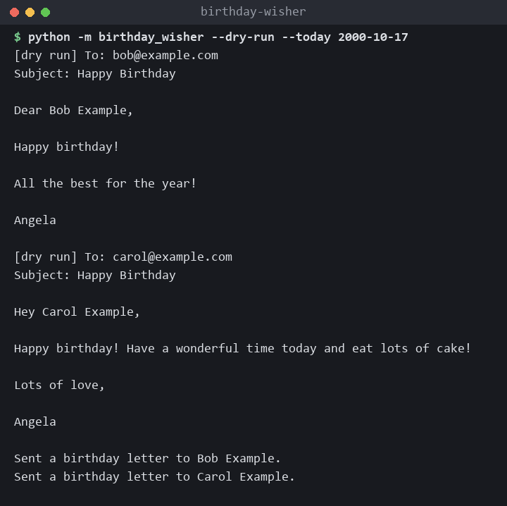
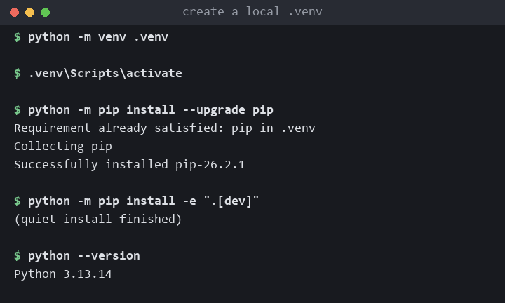
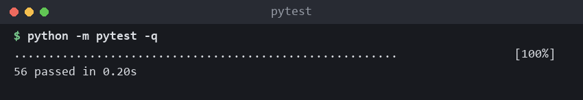

# 🚀 Birthday Wisher

Sends a random birthday letter by e-mail to everyone in `birthdays.csv` whose birthday is today. It is the "normal" level of day 32 of Udemy's *100 Days of Code: The Complete Python Pro Bootcamp*, written for course participants and for anyone who browses the repository for ideas.

## 📚 Table of Contents

- [Overview](#-overview)
- [Requirements](#-requirements)
- [Setup](#-setup)
- [Run](#-run)
- [Tests](#-tests)
- [License](#-license)
- [Links](#-links)
- [Appendix: Project documents](#-appendix-project-documents)

## 🧭 Overview

The program reads `birthdays.csv`, compares today's month and day with each row, picks one of `letter_templates/letter_1.txt` to `letter_3.txt` at random, replaces `[NAME]` with the person's name and sends the letter through SMTP with STARTTLS (Gmail by default). It uses only the Python standard library, so it has no runtime dependencies.



| Path | What it is |
| --- | --- |
| `src/birthday_wisher/` | The program: `domain`, `application`, `infrastructure` and `presentation` layers, constants in `constants.py` |
| `tests/` | pytest tests: `unit`, `integration`, `e2e`; all run offline |
| `birthdays.csv` | The people: `name,email,year,month,day` (dummy data) |
| `letter_templates/` | Three letters with the `[NAME]` placeholder |
| `Doxyfile` | Doxygen configuration; the source carries Doxygen comments |
| `docs/` | Project documents, images and the wiki in English, Danish and Bahasa Malaysia |

## 📋 Requirements

- Python 3.13 or newer, to run the program and the tests.
- A Gmail address and an app password, only to send real e-mail. A dry run and the tests need neither.
- Doxygen, only to build the API documentation (optional).

## 🛠️ Setup

Create and use a local virtual environment, then upgrade pip and install the project with its test tools:

```bash
python -m venv .venv
```

Activate it. On Windows (PowerShell): `.venv\Scripts\Activate.ps1`. On Windows (cmd): `.venv\Scripts\activate`. On Linux and macOS: `source .venv/bin/activate`.

```bash
python -m pip install --upgrade pip
python -m pip install -e ".[dev]"
```



To send real e-mail, set two environment variables (see `.env.example`; never commit a real `.env`):

```bash
export GMAIL_ADDRESS="you@gmail.com"
export GMAIL_TOKEN="your-app-password"
```

On Windows PowerShell use `$env:GMAIL_ADDRESS = "you@gmail.com"` and `$env:GMAIL_TOKEN = "your-app-password"`.

## ▶️ Run

Print the letters instead of sending them (pretend today is 17 October 2000):

```bash
python -m birthday_wisher --dry-run --today 2000-10-17
```

Send the letters for today's birthdays:

```bash
python -m birthday_wisher
```

Options: `--dry-run`, `--today YYYY-MM-DD`, `--csv FILE`, `--letters FOLDER`. The program exits with status 1 when setup is wrong or a letter could not be sent. Generate the API documentation with `doxygen Doxyfile` (output in `docs/doxygen/`).

## 🧪 Tests

```bash
python -m pytest
```

The tests use a fake SMTP connection and temporary files. They need no network, no `.env` and no credentials.



## 📄 License

GNU Affero General Public License v3.0, see [LICENSE](LICENSE).

## 🔗 Links

- [Repository][repository]
- [Documentation][documentation]
- [Issue tracker][issues]

## 📎 Appendix: Project documents

| Document | What it tells you |
| --- | --- |
| [AGENTS.md][agents] | The rules AI agents follow in this repository |
| [Business Case][BC-001] | Why the project exists, its scope and success criteria |
| [Stakeholder Analysis][SA-001] | Who is involved; the stakeholder IDs used for owners and reviewers |
| [Project Plan][PP-001] | The gateways and their schedule |
| [Milestones][milestones] | One document per gateway: Go/No-Go criteria and tasks |
| [Artifact registry][registry] | Where each artifact type lives, the next version, the PO language and domain |
| [Framework README][framework-readme] | The framework this project uses |
| [Framework changelog][framework-changelog] | What changed in each framework release |

---

[repository]: https://git.tirsystem.com/Tirsvad-Udemy-100-days-of-code/032-birthday-wisher
[documentation]: https://git.tirsystem.com/Tirsvad-Udemy-100-days-of-code/032-birthday-wisher/wiki
[issues]: https://git.tirsystem.com/Tirsvad-Udemy-100-days-of-code/032-birthday-wisher/issues
[agents]: ./AGENTS.md
[BC-001]: ./docs/business-case.md
[SA-001]: ./docs/stakeholder-analysis.md
[PP-001]: ./docs/project-plan.md
[milestones]: ./docs/milestones/
[registry]: ./docs/artifact-registry.md
[framework-readme]: ./framework/README.md
[framework-changelog]: ./framework/CHANGELOG.md
