# Project Plan

## Metadata
| Key | Value |
| --- | --- |
| ID | PP-001 |
| CrossReference | [BC-001], [SA-001], [MIL-001], [MIL-002], [MIL-003] |
| Language | en |
| Domain | it |

## Version History
| Date | Status | Author | Reviewer | Change | Commit |
| --- | --- | --- | --- | --- | --- |
| 2026-10-17 | Accepted | Jens Tirsvad Nielsen | S01 | Initial version; accepted by S01 (AI as stand-in, plan accepted in chat 2026-10-17) | [052008f] |

---

## Purpose

This plan schedules the three phases that deliver the birthday wisher of [BC-001]: project setup, the core program, and documentation with publication. It is scheduled against the Business Case constraint of one pull request per milestone.

## Planning Assumptions

- Work starts 2026-10-17 and the plan ends by 2026-10-20.
- Each phase is one day; each phase is one branch and one pull request that closes its issues.
- Autonomous mode: the AI runs all phases after the user accepts this plan; the review of each artifact is by S01's stand-in and recorded as not independent ([SA-001]).

## Gateway Schedule

| Gateway | Document | Window | Decision date | Owner | Stories | Main deliverable | Milestone |
| --- | --- | --- | --- | --- | --- | --- | --- |
| G1 Project setup | [MIL-001] | 2026-10-17 to 2026-10-18 | 2026-10-18 | S01 | none (plain tasks) | Skeleton, tooling, repository metadata | |
| G2 Core | [MIL-002] | 2026-10-18 to 2026-10-19 | 2026-10-19 | S01 | none (plain tasks) | Working, tested birthday wisher | |
| G3 Documentation | [MIL-003] | 2026-10-19 to 2026-10-20 | 2026-10-20 | S01 | none (plain tasks) | README, tri-lingual wiki, screenshots | |

```plantuml
@startgantt
Project starts 2026-10-17
[G1 Project setup] starts 2026-10-17 and ends 2026-10-18
[G2 Core] starts 2026-10-18 and ends 2026-10-19
[G3 Documentation] starts 2026-10-19 and ends 2026-10-20
[G1 Go/No-Go] happens 2026-10-18
[G2 Go/No-Go] happens 2026-10-19
[G3 Go/No-Go] happens 2026-10-20
@endgantt
```



## Scope Coverage

| Business Case scope item | Gateway |
| --- | --- |
| CSV reading, matching, letters, SMTP sending | G2 |
| `src/`, `tests/`, `constants.py`, `pyproject.toml`, `.gitignore`, `.env.example`, Doxyfile | G1 |
| Repository description and topics | G1 |
| README and wiki in en, da, ms with screenshots | G3 |

## Dependencies

```
G1 Project setup -> G2 Core -> G3 Documentation
```

A No-Go at a gate moves every later date by the time needed to fix and re-review it.

## Plan Risks

| Risk | Impact | Mitigation |
| --- | --- | --- |
| The git host token cannot set topics or merge | Gate G1 or the merge is blocked | Stop and report; the user supplies or fixes the token |
| A screenshot cannot be produced without the host desktop | G3 delayed | Render terminal output to an image with a script, never on the host desktop |
| Danish or Malay translation quality | Readers misled | Keep sentences short, keep code in English; S01 can challenge in the run summary |

## Open Issues

- The repository named in the request (`https://git.tirsystem.com/Tirsvad-Udemy-100_days_of_code`) is the organisation; the project is published to this clone's `origin`, `Tirsvad-Udemy-100-days-of-code/032-birthday-wisher`. Please confirm.
- No use case or user story is written: the tasks are plain technical tasks for a one-feature learning project, so the plan-first gate is met through the "plain technical task" route. Say so if a use case should be written.
- The course hints use pandas; the project uses the standard `csv` module (no runtime dependencies, objective in [BC-001]).
- Support for 29 February birthdays is decided during G2 and documented.

---

[BC-001]: ./business-case.md
[SA-001]: ./stakeholder-analysis.md
[MIL-001]: ./milestones/mil-001-project-setup.md
[MIL-002]: ./milestones/mil-002-birthday-wisher-core.md
[MIL-003]: ./milestones/mil-003-documentation-and-publication.md
[052008f]: https://git.tirsystem.com/Tirsvad-Udemy-100-days-of-code/032-birthday-wisher/commit/052008f21364120a7c4d5ebbff26b8c16e05a21c
